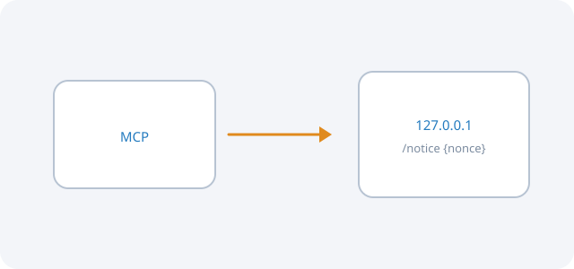

Opt-in receiver for the network test channel. It listens on `127.0.0.1` and accepts only `POST /notice` with `{"nonce":"<16 hex>"}`, a bearer token read from a local file, and `Content-Type: application/json`.

The notice is constant, names no mail body, and is queued into exactly one pinned `sessionId`. A closed or foreign session is refused (`409`) and no other session is woken. `202` means the notice was queued, never that a mail was read.
